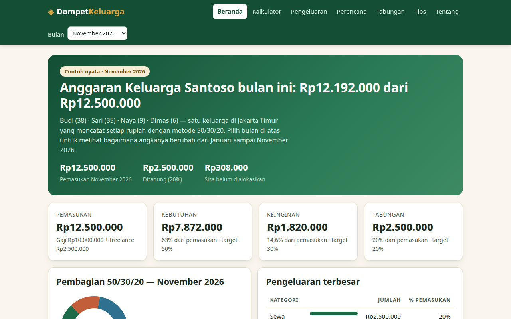
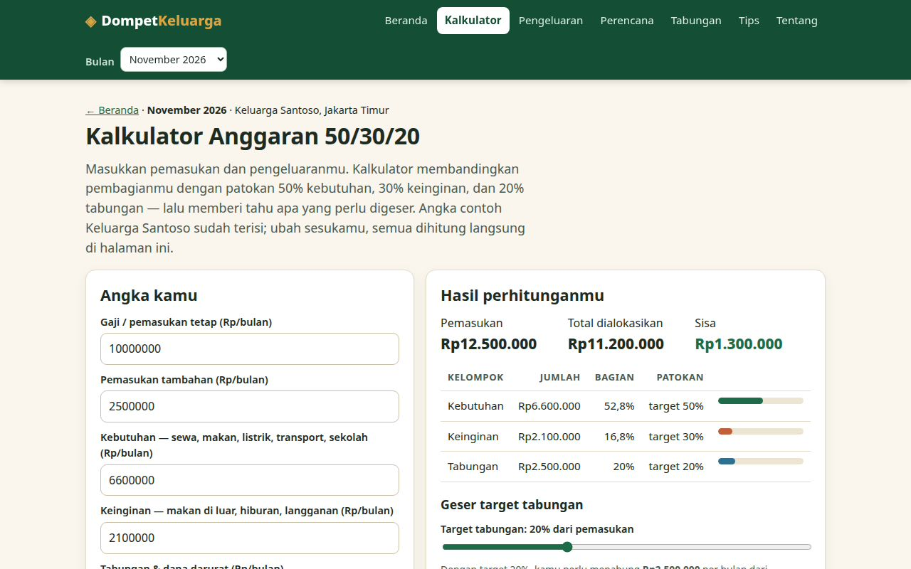
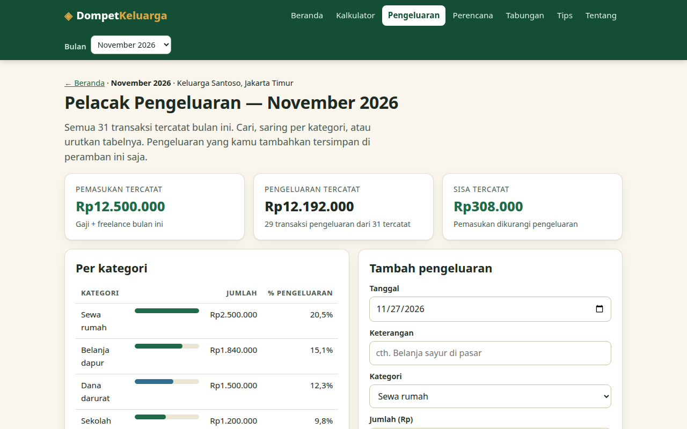
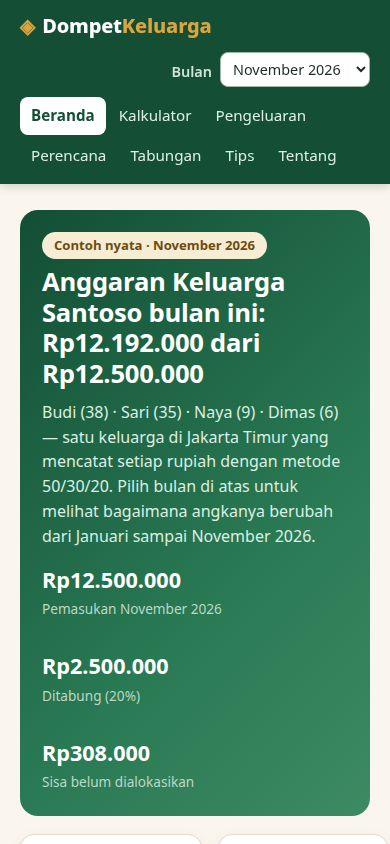

# DompetKeluarga

DompetKeluarga is an Indonesian household-budget site (IDR) for a fictional
household, Keluarga Santoso (Jakarta Timur). Seven hash-routed sections:
Beranda (dashboard with a 50/30/20 SVG donut and biggest-expense bars),
Kalkulator (live 50/30/20 calculator with verdict and savings-target slider),
Pengeluaran (31 transactions, searchable / filterable / sortable, add your own
with localStorage), Perencana (monthly plan vs actual, editable, month picker
Jan–Nov 2026 changes all figures), Tabungan (4 savings goals with progress
and contributions), Tips (8 tips, filterable), Tentang (method and privacy).

Sample figures (November 2026): income Rp12.500.000 (salary 10jt + freelance
2,5jt); needs Rp7.872.000 (63%), wants Rp1.820.000 (14,6%), savings
Rp2.500.000 (20%); spent Rp12.192.000, left Rp308.000. All category totals
reconcile with the transaction list.

The site is plain static files in `app/` — open `app/index.html` in a browser,
no build step, no network requests, no account. Serve locally with
`node serve.ts` (http://localhost:8080). `main.ts` (Node 22, standard library
only) hands the site in: it copies `app/` and `screenshots/` to the output
directory and writes `dossier.json`.

## Screenshots

